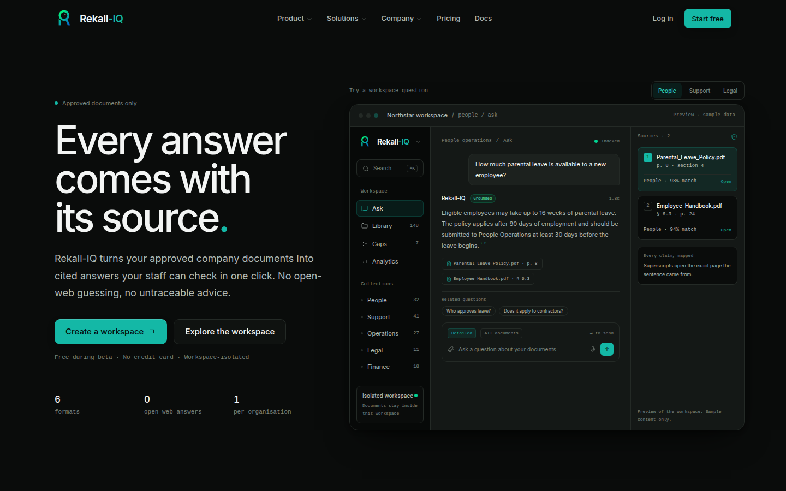

# Rekall-IQ

### Every answer comes with its source.

Rekall-IQ turns the documents your company has approved into cited answers your
team can check in one click.

[Explore the product](https://rekalliq.springvoxsl.com/product) ·
[Read the docs](https://rekalliq.springvoxsl.com/docs) ·
[See pricing](https://rekalliq.springvoxsl.com/pricing)



## The problem

Company knowledge is rarely missing. It is just hard to trust.

- Policies live in shared drives, chat threads, and inboxes.
- Staff ask the same questions and get different answers.
- Nobody can see which questions the documents fail to answer.
- A confident answer is not the same as a checkable one.

## What Rekall-IQ does

Rekall-IQ gives every workspace one approved document library and one place to
ask questions against it.

- **Cited answers** — every reply names the file, page, and section behind it.
- **Approved documents only** — answers come from your library, not the open web.
- **Workspace isolation** — each company has its own private, access-controlled space.
- **Collections** — scope a question to People, Finance, Legal, Operations, or another department.
- **Knowledge gaps** — questions without a source become a ranked backlog for admins.
- **Answer evaluations** — test retrieval quality against your own golden questions.

## Why teams use it

| General assistant | Rekall-IQ |
|---|---|
| Answers from the open web | Answers from approved documents |
| Sounds confident | Shows the passage behind the answer |
| No record of missing knowledge | Tracks the questions the documents cannot answer |
| One shared context | Workspace-scoped access and collections |

## Built for the teams that get asked

- **People and HR** — onboarding, leave, and benefits without the repeat questions.
- **Support** — playbooks and escalation paths at the moment of the ticket.
- **Legal and compliance** — approved wording with the policy section attached.
- **Operations** — one procedure across every site and shift.

## Answers you can inspect

A Rekall-IQ answer is a document, not a chat bubble. The reply is assembled from
retrieved passages, and every sentence that depends on a source carries a
numbered citation. Open a citation to read the original page beside the answer.

That is the product’s signature: **the receipt comes with the answer.**

## Trust and security

- Supabase Auth validates every request server-side.
- Tenant data is scoped by `workspace_id` and protected by RLS.
- Roles separate Platform Admin, Workspace Admin, and Viewer access.
- Uploads are validated by extension, size, and file signature.
- Platform operators see operational metadata, not tenant document contents.
- Audit logs record administrative actions.

[Read the security overview](https://rekalliq.springvoxsl.com/security) ·
[Data handling](https://rekalliq.springvoxsl.com/data-handling)

## How it works

1. **Upload** the documents your organisation has approved.
2. **Ask** in plain English, scoped to the whole library or one collection.
3. **Check** the cited page before you act on the answer.

For the technical pipeline, see [docs/engineering.md](docs/engineering.md).

## Start locally

```bash
npm install
cp .env.example .env
# Configure Supabase, Qdrant, Gemini, Voyage, Inngest, and optional Resend
npm run dev
```

Then follow the full setup, migration, and deployment steps in
[docs/deployment-guide.md](docs/deployment-guide.md).

For development workflow and validation commands, see
[CONTRIBUTING.md](CONTRIBUTING.md).

## Project status

**Controlled beta.** The core product, viewer workspace, tenant admin, platform
admin, security hardening, AI intelligence, and performance instrumentation are
implemented. Billing is handled manually during beta.

Open launch work is tracked in [docs/launch-blockers.md](docs/launch-blockers.md).

## Documentation

- [Product and architecture](docs/architecture-guide.md)
- [Engineering guide](docs/engineering.md)
- [Deployment](docs/deployment-guide.md)
- [Security](docs/security-guide.md)
- [AI intelligence](docs/ai-intelligence.md)
- [Performance baseline](docs/performance-baseline.md)
- [Support runbook](docs/support-runbook.md)

## Contact

- Product and sales: [hello@springvoxsl.com](mailto:hello@springvoxsl.com)
- Support: [support@springvoxsl.com](mailto:support@springvoxsl.com)
- Security: [security@springvoxsl.com](mailto:security@springvoxsl.com)

© 2026 Rekall-IQ
